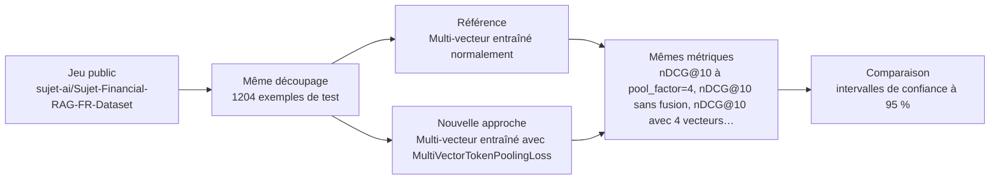
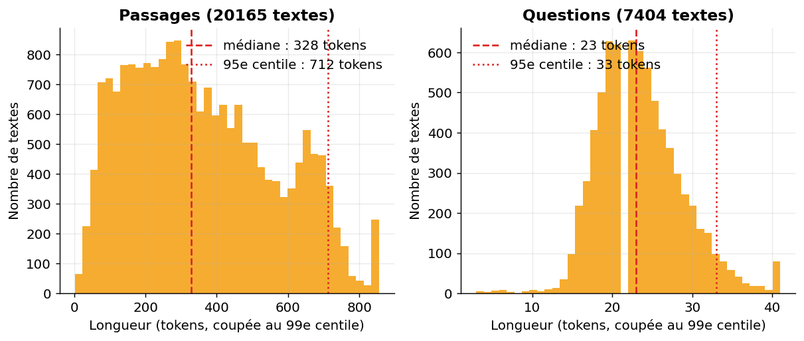
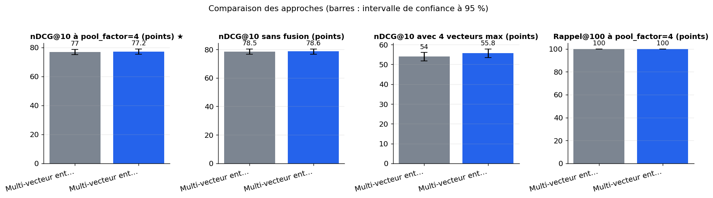
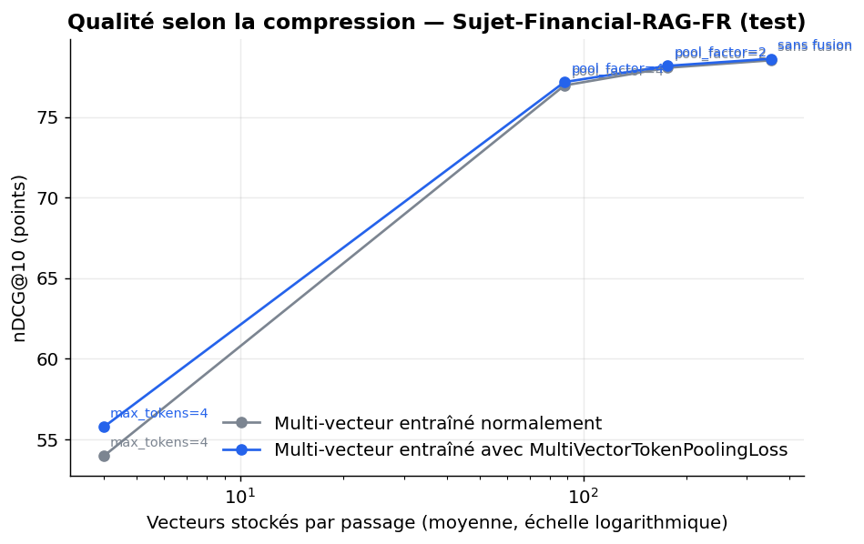
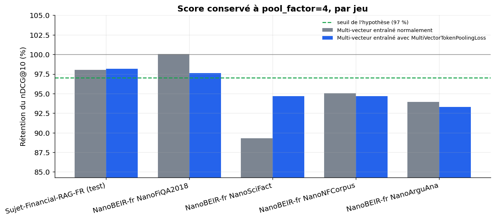
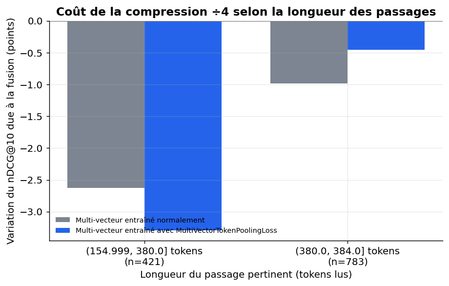
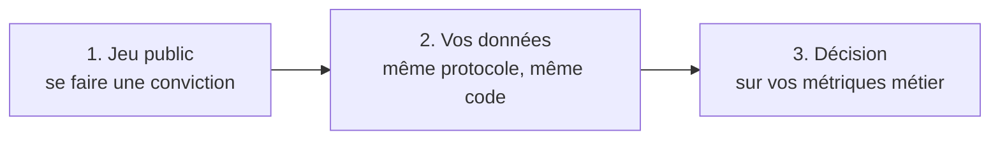

# Le gain d'un entraînement multi-vecteur conscient du token pooling (index ÷4) se retrouve-t-il en français ?

> **En bref.** Le gain annoncé n'est pas retrouvé en français : l'écart est négligeable et non significatif, et la compression coûte déjà peu à un modèle ordinaire. Résultat non concluant, limité par un seul entraînement et une perte réimplémentée. nDCG@10 à pool_factor=4 : 77,2 [75,3 ; 79,1] pour Multi-vecteur entraîné avec MultiVectorTokenPoolingLoss, contre 77 [75 ; 78,8] pour Multi-vecteur entraîné normalement (1204 exemples de test, échelle complète).

## Sommaire

1. [La question](#la-question)
2. [Le protocole](#le-protocole)
3. [Les résultats](#les-résultats)
4. [Ce qu'il faut retenir](#ce-quil-faut-retenir)
5. [Rejouer l'expérience](#rejouer-lexpérience)
6. [Contenu du dépôt](#contenu-du-dépôt)
7. [Références](#références)
8. [Glossaire](#glossaire)

## La question

Un moteur de recherche multi-vecteur garde un vecteur par mot de chaque passage : il est précis, mais son index est très lourd. Pour l'alléger, on peut fusionner les vecteurs proches et en garder quatre fois moins, au prix d'une perte de qualité. L'expérience vérifie en français, sur des textes financiers, si un modèle entraîné à fonctionner aussi avec ces vecteurs fusionnés perd moins de qualité qu'un modèle entraîné normalement puis compressé après coup. Les deux modèles ne diffèrent que par leur perte d'entraînement. La comparaison dit si cet entraînement spécial vaut la peine pour un index divisé par quatre.

**Hypothèse testée.** En français, à pool_factor=4, le modèle entraîné avec MultiVectorTokenPoolingLoss obtient au moins 2 points de nDCG@10 de plus que le modèle entraîné normalement puis compressé, et retient ≥ 97 % de son score non compressé contre ≤ 95 % pour le modèle ordinaire.

| | Référence | Nouvelle approche |
|---|---|---|
| **Approche** | Multi-vecteur entraîné normalement | Multi-vecteur entraîné avec MultiVectorTokenPoolingLoss |
| **Principe** | Encodeur multi-vecteur de type ColBERT entraîné avec la perte de recherche standard, puis compressé après coup par token pooling (Ward). | Perte moyenne entre recherche sur vecteurs d'origine et sur vecteurs fusionnés (facteur 4), avec estimateur straight-through pour traverser le clustering. |
| **Mise en œuvre** | sentence-transformers 6.3+, MultiVectorEncoder avec projection 128 dimensions sur almanach/moderncamembert-base, perte de recherche multi-vecteur à négatifs dans le lot, 1 époque sur paires question/passage ; token pooling appliqué aux documents à pool_factor 1, 2, 4 et max_tokens 4 ; mêmes hyperparamètres que la nouvelle approche. Vérifier l'API réelle de la version installée avant usage. | Même modèle de base, mêmes données, même graine ; seule la perte change (MultiVectorTokenPoolingLoss de sentence-transformers 6.3, pool_factor=4). Évaluation avec un évaluateur nDCG@10 maison sur corpus/queries/qrels remis à plat. |
| **Modèles** | [`almanach/moderncamembert-base`](https://huggingface.co/almanach/moderncamembert-base) | [`almanach/moderncamembert-base`](https://huggingface.co/almanach/moderncamembert-base) |

## Le protocole



- **Données** : [`sujet-ai/Sujet-Financial-RAG-FR-Dataset`](https://huggingface.co/datasets/sujet-ai/Sujet-Financial-RAG-FR-Dataset) (configuration `default`), évaluation sur le découpage `test` (1204 exemples). Le split test (1 209 questions, corpus = passages du test) donne un corpus financier français sous licence MIT ; le sous-ensemble de NanoBEIR-fr reproduit le protocole de la source sur des domaines variés avec jugements de pertinence.
- **Écarts avec des données réelles** : Un seul positif par question, questions probablement générées, tableaux mal alignés ; NanoBEIR-fr est traduit automatiquement, peu financier, licence non précisée ; entraînement sur un sous-échantillon de quelques milliers de paires au lieu de 120 000 triplets ; pas de comparaison à une recherche hybride.
- **Déroulé** : Deux encodeurs multi-vecteurs (ModernCamemBERT et une projection à 128 dimensions) partent de la même initialisation. Ils sont entraînés une époque sur les mêmes paires question/passage du split train de Sujet-Financial-RAG-FR, retirées si elles apparaissent dans le test, avec les mêmes lots et les mêmes hyperparamètres ; seule la perte diffère (standard ou moyenne standard/fusionnée à pool_factor=4). L'évaluation porte sur le split test, avec pour corpus les passages du test, et sur des sous-jeux NanoBEIR-fr. La recherche MaxSim est exhaustive, sans fusion puis à pool_factor 2 et 4 et à max_tokens 4. On rapporte le nDCG@10 (métrique principale à pool_factor=4), le rappel@100, la rétention du score, le nombre de vecteurs par passage, la taille d'index et la latence, avec des intervalles de bootstrap appariés sur les requêtes. Le verdict est fixé à l'avance et suppose que chaque modèle batte d'abord un classement aléatoire.
- **Deux échelles, un seul code** : l'échelle réduite (100 exemples, CPU, 12 min) valide la mécanique ; l'échelle complète (GPU T4 (Google Colab), 21 min) donne les résultats.



*Longueur en tokens des passages (à gauche) et des questions (à droite), tous jeux confondus. Les traits verticaux marquent la médiane et le 95e centile : la longueur maximale retenue doit couvrir au moins 95 % des textes.*

**Les métriques**

| Métrique | Ce qu'elle mesure | Meilleur si |
|---|---|---|
| nDCG@10 à pool_factor=4 ★ | Qualité du classement des 10 premiers résultats (0 à 100) avec un index compressé par 4 ; c'est la métrique principale. | plus haut |
| nDCG@10 sans fusion | Qualité du classement du même modèle avec tous ses vecteurs, sans compression. | plus haut |
| nDCG@10 avec 4 vecteurs max | Qualité du classement quand chaque passage est réduit à 4 vecteurs au plus (compression extrême). | plus haut |
| Rétention du score | Part du nDCG@10 non compressé conservée à pool_factor=4 par le même modèle (1 = aucune perte). | plus haut |
| Rappel@100 | Part des passages pertinents retrouvés dans les 100 premiers résultats, index compressé par 4. | plus haut |
| Vecteurs par passage | Nombre moyen de vecteurs stockés par passage à pool_factor=4 ; il est identique pour les deux approches. | plus bas |
| Taille d'index (Mo) | Place occupée par les vecteurs du corpus évalué, stockés en float16, à pool_factor=4. | plus bas |
| nDCG@10 moyen NanoBEIR-fr | nDCG@10 à pool_factor=4 moyenné sur les sous-jeux NanoBEIR-fr ; il est sans objet (None) dans l'environnement cible. | plus haut |

★ métrique principale : c'est elle qui tranche la question.

## Les résultats

| Approche | nDCG@10 à pool_factor=4 ★ ↑ | nDCG@10 sans fusion ↑ | nDCG@10 avec 4 vecteurs max ↑ | Rappel@100 ↑ | Rétention du score ↑ | Vecteurs par passage ↓ | Taille d'index (Mo) ↓ | nDCG@10 moyen NanoBEIR-fr ↑ | Latence médiane (ms) ↓ |
|---|---|---|---|---|---|---|---|---|---|
| Multi-vecteur entraîné normalement (référence) | 77 [75 ; 78,8] | 78,5 [76,6 ; 80,3] | 54 [51,8 ; 56,1] | 100 [100 ; 100] | 0,98 [0,97 ; 0,99] | 88,2 | 1,35 | **38,6** | 22,9 |
| Multi-vecteur entraîné avec MultiVectorTokenPoolingLoss (nouvelle approche) | **77,2 [75,3 ; 79,1]** | **78,6 [76,7 ; 80,4]** | **55,8 [53,5 ; 57,9]** | 100 [100 ; 100] | **0,982 [0,973 ; 0,99]** | 88,2 | 1,35 | 38,3 | 23,4 |

★ métrique principale · ↑ plus haut = meilleur · ↓ plus bas = meilleur · entre crochets : intervalle de confiance à 95 % (bootstrap) · en gras : la meilleure valeur.



*nDCG@10 à pool_factor=4 (métrique principale), sans fusion et avec 4 vecteurs au plus, puis rappel@100, sur le jeu principal. Les barres d'erreur sont les intervalles de confiance à 95 % (bootstrap sur les requêtes).*



*nDCG@10 du jeu principal selon le nombre moyen de vecteurs gardés par passage (de droite à gauche : sans fusion, pool_factor=2, pool_factor=4, 4 vecteurs au plus). Une courbe qui reste haute vers la gauche résiste mieux à la compression.*



*Part du nDCG@10 non compressé conservée à pool_factor=4, pour chaque jeu et chaque approche. Au-dessus du trait vert, l'objectif de 97 % est atteint ; au-dessus de 100 %, la compression améliore même le classement.*



*Variation moyenne du nDCG@10 entre pool_factor=4 et l'absence de fusion, par tiers de longueur du passage pertinent. Une barre sous 0 indique une perte due à la compression ; plus elle est courte, mieux le modèle résiste.*

**Lecture** (confiance moyenne). La comparaison est correcte sur le plan du protocole : mêmes données, même initialisation, mêmes lots, même nombre de pas (188), mêmes évaluations appariées, sans fuite apparente. À l'échelle complète (1 204 requêtes, GPU), à pool_factor=4, le nDCG@10 est de 77,16 pour la nouvelle approche contre 76,96 pour la référence, soit +0,21 point avec un intervalle apparié de [−0,57 ; +1,05]. Les rétentions sont presque identiques (98,2 % vs 98,0 %). L'hypothèse (≥ 2 points, 97 % vs ≤ 95 %) n'est pas confirmée et le résultat est non concluant, et non une preuve d'absence d'effet. La source (+2,2 points, 97,8 % vs 94,6 %) n'est pas reproduite, mais le protocole diffère (un seul entraînement de 6 000 paires, une perte réimplémentée, un jeu financier facile où la référence perd déjà peu). Sous max_tokens=4, l'avantage apparent (+1,8 point) reste non testé.

## Ce qu'il faut retenir

**Réserves**

- Le résultat concerne une réimplémentation de l'objectif, pas la perte livrée par la bibliothèque ; l'absence d'effet pourrait venir d'écarts d'implémentation.
- L'écart observé est dans le bruit d'un seul entraînement ; on ne peut conclure ni à l'absence ni à la présence d'un petit effet réel.
- Sur ce jeu facile, la compression coûte déjà peu à un modèle ordinaire ; l'absence de gain ne prouve pas que l'entraînement conscient du pooling soit inutile sur des corpus plus exigeants.

**Limites**

- Un seul entraînement par approche et une seule graine : on ne connaît pas la variance entre graines, donc un écart de 1 à 2 points reste fragile.
- Une seule paire pertinente par question dans le jeu principal, avec des questions probablement générées automatiquement ; NanoBEIR-fr est traduit automatiquement et peu centré sur les services financiers.
- L'entraînement se fait sur quelques milliers de paires, avec des négatifs dans le lot, au lieu de 120 000 triplets avec un négatif difficile comme dans la source.
- La perte est réimplémentée en PyTorch, et le clustering de Ward est calculé par SciPy sur CPU ; le coût d'indexation n'est pas mesuré.
- Pas de comparaison à une recherche hybride ni à un index approché : la recherche est exhaustive sur des corpus de taille modeste.

**Pistes d'amélioration**

- La tendance à l'avantage de la nouvelle approche en compression extrême est suggestive, mais non démontrée statistiquement.

## Rejouer l'expérience



### Sur le jeu public

```bash
pip install -r requirements.txt
jupyter lab experiment.ipynb
```

Dans la cellule de paramètres : `PHASE = "public"`, puis `SCALE = "reduced"` (quelques minutes sur CPU, pour vérifier) ou `SCALE = "full"` (résultats publiés ; GPU T4 (Google Colab), 21 min). Les résultats sont écrits dans `outputs/results_public.json`, les figures dans `outputs/figures/` (les résultats publiés en sont une copie, dans `results/` et `figures/`).

### Sur vos données (environnement de services financiers)

Le même protocole, sur vos données, dans votre environnement : seule la cellule `PRIVATE_CONFIG` s'adapte. Le code de cette phase a été exécuté de bout en bout sur un jeu factice écrit comme un vrai export (dossier de fichiers, CSV « ; » en Windows-1252, colonnes à faire correspondre), contre un service simulé à la convention OpenAI (clé lue dans un fichier de secret), modèles chargés hors ligne.

**1. Préparer le jeu de données.** Colonnes attendues (les noms peuvent différer : on les fait correspondre dans `PRIVATE_CONFIG["columns"]`) :

| Colonne attendue | Type | Contenu |
|---|---|---|
| `query` | string | Question d'un utilisateur métier. |
| `passage_id` | string | Identifiant du passage ou document. |
| `passage_text` | string | Texte du passage. |
| `relevance` | int | Jugement de pertinence (0 à 3) requête/passage. |
| `document_date` | datetime | Date de version du document. |

Volume conseillé : ≥ 200 requêtes jugées, ≥ 20 000 passages, avec au moins 5 000 paires d'entraînement.

**Conditions pour que la comparaison soit concluante**

- Au moins 200 requêtes d'utilisateurs métier avec 2 jugements annotés ou plus par requête.
- Jugements en trois niveaux de pertinence, vérifiés par deux annotateurs sur un échantillon.
- Passages de plusieurs centaines de tokens, représentatifs des documents réels (procédures, conditions générales).
- Découpage par document, pas par passage, pour éviter les fuites.
- Retirer les données personnelles des documents et requêtes.
- Inclure la version courante des documents uniquement, avec date de version.
- Prévoir un lot d'entraînement distinct de 5 000 paires au moins.

**Constituer l'extraction.** Rassembler les bases documentaires de procédures et de produits, découper en passages, collecter des requêtes issues de questions réelles, faire annoter les passages pertinents pour un échantillon, puis séparer entraînement et évaluation par document.

**2. Rendre les modèles disponibles hors ligne** (si l'environnement n'a pas accès à Internet) :

```bash
python download_models.py ./models --scale full   # sur un poste connecté
```

puis copier le dossier dans l'environnement et le désigner par `LOCAL_MODELS_DIR`. Les révisions téléchargées sont celles des résultats publiés.

**3. Configurer** l'environnement du notebook à partir de `private.env.example` (ou directement la cellule `PRIVATE_CONFIG`). Jamais de clé dans le notebook : une variable, un fichier de secret monté ou la saisie masquée.

| Variable | Rôle |
|---|---|
| `PRIVATE_DATA` | jeu de données : fichier ou dossier (csv, tsv, parquet, jsonl, json, xlsx) ; `fake` pour tester le code sur un jeu factice |
| `LOCAL_MODELS_DIR` | (facultatif) dossier des poids copiés localement (`org--nom/`), pour travailler sans Internet |
| `HTTPS_PROXY, SSL_CERT_FILE, PIP_INDEX_URL` | (facultatif) proxy, autorité de certification et miroir PyPI d'entreprise |
| `SERVICE_TIMEOUT_S, SERVICE_MAX_RETRIES` | (facultatif) délai (120 s) et tentatives (3) par appel de service |

**4. Lancer** avec `PHASE = "private"` (et `SCALE = "full"`). La cellule d'initialisation affiche une liste de contrôle (jeu, colonnes, modèles, services) et s'arrête sur ce qui manque, avant tout calcul. Les résultats sont écrits dans `outputs/results_private.json` (avec versions, machine, graine et empreinte des données).

**5. Interpréter.** Métriques métier à suivre : nDCG@10, rappel@100, taille d'index par million de passages, temps d'indexation et de requête.

**Garde-fous.** Pas de fuite entre passages d'entraînement et d'évaluation d'un même document ; index internes non exportés ; conclusion limitée si moins de 200 requêtes. En phase `private`, le notebook refuse les services publics (OpenAI, Anthropic, Mistral, Hugging Face…) et le HTTP non chiffré, n'affiche aucune donnée brute et coupe la télémétrie des bibliothèques ; avec `LOCAL_MODELS_DIR`, il travaille sans accès à Internet.

## Contenu du dépôt

| Fichier | Contenu |
|---|---|
| `experiment.ipynb` | le notebook : question, données, deux approches, évaluation, analyse, bilan (sorties incluses) |
| `helpers.py` | fonctions communes : phases et échelles, services internes, lecture des données, mesures, figures |
| `results/results.json` | résultats publiés (échelle complète) : métriques, intervalles, latences, versions et machine |
| `results/results_reduced_scale.json` | résultats de l'échelle réduite (validation de la mécanique, CPU) |
| `figures/` | figures du notebook reprises dans ce README |
| `requirements.txt` | versions exactes des bibliothèques utilisées |
| `private.env.example` | variables d'environnement pour exécuter le notebook sur vos données |
| `download_models.py` | téléchargement des poids des modèles, pour un environnement sans Internet |

## Références

**Sources de l'approche**

- [Token Pooling-Aware Training for Multi-Vector Embedding Models](https://huggingface.co/blog/token-pooling)
- [sentence-transformers v6.3.0 release notes](https://github.com/huggingface/sentence-transformers/releases/tag/v6.3.0)

**Autres jeux de données examinés**

| Jeu | Accès | Intérêt | Pourquoi pas ici |
|---|---|---|---|
| [lightonai/NanoBEIR-fr](https://huggingface.co/datasets/lightonai/NanoBEIR-fr) | Hugging Face, libre | Seconde traduction de NanoBEIR. | Redondant avec CATIE-AQ ; contrôle de robustesse ultérieur possible. |
| [mteb/MIRACLRetrieval](https://huggingface.co/datasets/mteb/MIRACLRetrieval) | Hugging Face, libre | Requêtes françaises natives, grand corpus Wikipédia. | Corpus trop volumineux pour l'encodage dans le budget T4 sans échantillonnage. |
| [mteb/SyntecRetrieval](https://huggingface.co/datasets/mteb/SyntecRetrieval) | Hugging Face, libre | Corpus réglementaire français natif. | 90 documents : trop petit pour juger un index. |
| [unicamp-dl/mmarco](https://huggingface.co/datasets/unicamp-dl/mmarco) | accès restreint | MS MARCO traduit, le plus proche de la source. | Script de chargement, non parquet ; licence non commerciale à valider. |
| [vidore/vidore_v3_finance_fr](https://huggingface.co/datasets/vidore/vidore_v3_finance_fr) | Hugging Face, libre | Pages financières longues avec qrels. | Colonne image lourde à télécharger ; piste ultérieure via la colonne markdown. |

**Licences**

- Jeu de données `sujet-ai/Sujet-Financial-RAG-FR-Dataset` : mit
- `almanach/moderncamembert-base` : mit
- Vérifier la licence de chaque modèle avant tout usage au-delà de l'évaluation.

## Glossaire

| Terme | Définition |
|---|---|
| **Modèle multi-vecteur (ColBERT)** | Encodeur qui représente un texte par un vecteur par token, au lieu d'un seul vecteur pour tout le texte. |
| **MaxSim** | Score requête/passage : chaque token de la requête prend sa meilleure similarité avec un vecteur du passage, puis on additionne ces maxima. |
| **Token pooling** | Compression de l'index : les vecteurs proches d'un même passage sont fusionnés en leur moyenne, ce qui en réduit le nombre. |
| **Clustering de Ward** | Regroupement hiérarchique qui fusionne pas à pas les groupes dont la réunion augmente le moins la dispersion. |
| **pool_factor** | Facteur de réduction du nombre de vecteurs d'un passage : 4 veut dire environ quatre fois moins de vecteurs. |
| **Négatifs dans le lot** | Pendant l'entraînement, les passages des autres questions du même lot servent d'exemples de mauvaises réponses. |
| **Estimateur straight-through** | Astuce qui fige un choix non dérivable (ici le regroupement) tout en laissant le gradient revenir aux vecteurs d'origine. |
| **nDCG@10** | Mesure de la qualité d'un classement qui récompense les bons passages placés haut parmi les 10 premiers. |
| **Bootstrap apparié** | On retire les mêmes requêtes au hasard, avec remise, pour les deux termes comparés, afin d'obtenir un intervalle de confiance sur leur écart. |
